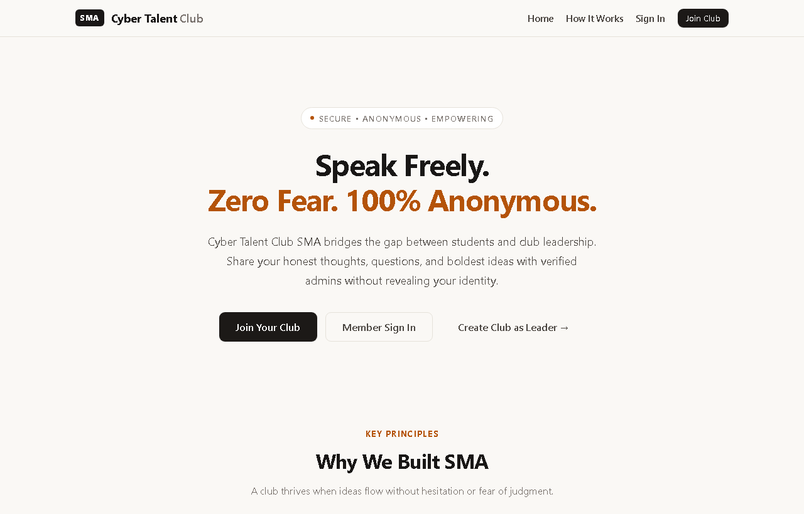

# SMA: Send Message Anonymously

[](https://clubsma.pythonanywhere.com/)
[](https://www.python.org/)
[](https://flask.palletsprojects.com/)
[](https://www.sqlite.org/)

An anonymous feedback system for school clubs and student teams. Members send honest messages to their club's leadership, and the leaders read them without ever seeing who wrote them.

🔗 **Live Website:** [https://clubsma.pythonanywhere.com/](https://clubsma.pythonanywhere.com/)

---

## 📸 Preview

<p align="center">
  
</p>

---

## About the Project

**SMA** stands for **Send Message Anonymously**. It is a Flask web application where every club gets its own private space:

1. A **Leader** creates a club and receives a unique club code (e.g., `SMA-7X9P2K`).
2. **Members** and **Admins** register and join using that exact code.
3. Members send anonymous messages (ideas, questions, suggestions) directly to the club.
4. Admins and the Leader read them in an inbox that displays only the message content and timestamp—never the sender's identity.

I built this project for the Cyber Talent Club at my school, but any student club or team can use it by creating their own club inside the app.

---

## Why I Made It
i got the idea when i was wondering what to build for terra hackclub and realized it is better if i build this because i can do 2 things at the same time. the idea minly come from the thought that. In a club, members often have great ideas or real concerns, but stay quiet because they are afraid of being judged, feeling awkward, or worrying about what leadership might think. Simply telling people to "just speak up" does not work for everyone.

I wanted a simple, safe way for members to say what they truly think without fear, while still protecting the club from spam and abuse. That's why:
- Messages are **strictly anonymous** (no student identity is linked to the message).
- Accounts are verified by club code.
- Every member has a **daily limit of 5 messages** to keep feedback thoughtful.

It was also a hands-on opportunity to build a complete backend application with authentication, role-based access control, relational database management, security principles, and cloud deployment.

---

## Features

### 🎓 For Members
* Send anonymous messages (up to 1,000 characters).
* Daily allowance of 5 messages per member to prevent spam.
* Live character counter and remaining quota display.
* Option to start your own club at any time.

### 🛡️ For Admins
* Read the club inbox with unread and total counters.
* Filter messages by all or unread only.
* Mark messages as read or delete handled items.

### 👑 For Leaders
* Generate and manage your unique Club Code to invite members.
* Approve or reject Admin registration requests.
* Suspend, reactivate, or remove members and admins from the roster.
* View club statistics (pending requests, active admins, total members, total messages).

### 🔐 For Everyone
* Secure registration, login, profile view, and password updates.

---

## How Anonymity Works

When a member sends a message, the server saves only:
- The `leader_id` (so it reaches the right club).
- The message `text`.
- The `created_at` timestamp and an `is_read` flag.

**No user ID, student name, or email is ever stored with the message**, making it technically impossible for anyone reading the inbox to see who wrote it.

The daily limit is tracked in a separate `send_limits` table that only records how many messages a user sent today. It has no foreign key or link to message content.

---

## 🛠️ Tech Stack

* **Backend:** Python 3.10+, Flask (Blueprints), Werkzeug
* **Database:** SQLite (persistent storage on PythonAnywhere)
* **Frontend:** Jinja2 templates, HTML5, CSS3, Vanilla JavaScript
* **Configuration:** `python-dotenv`
* **Hosting & Deployment:** [PythonAnywhere](https://www.pythonanywhere.com/) (WSGI) — Live at [clubsma.pythonanywhere.com](https://clubsma.pythonanywhere.com/)

---

## 🚀 Getting Started Locally

### Requirements
* Python 3.10 or newer
* Git (or download the ZIP file from GitHub)

### 1. Clone & Install

```bash
git clone https://github.com/Elyab1221/SMA.git
cd SMA
pip install -r requirements.txt
```

### 2. Run the App

* **On Windows:** Double-click **`run.bat`** (starts the server and opens your browser automatically).
* **On macOS / Linux / Terminal:**
  ```bash
  python app.py
  ```

Then open **`http://127.0.0.1:5050`** in your browser.

The database file (`sma.db`) is created automatically on the first run.

### 3. Try It Out

1. Click **Join Club** -> Select **Club Leader**, register, and copy your Club Code from the Leader Hub.
2. Open an incognito window, click **Join Club** -> Select **Club Member**, enter the Club Code, and register.
3. As the member, go to **Send Message** and submit anonymous feedback.
4. Go back to the Leader window, open the **Inbox**, and view the anonymous feedback!

You can also seed a Leader account directly from the command line:
```bash
python seed_leader.py
```

---

## Project Structure

```
SMA/
├── app.py               # Flask app, CSRF check, security headers, error handlers
├── auth.py              # Register, login, logout, password change, profile
├── student.py           # Member pages: send anonymous message, create club
├── admin.py             # Inbox: view, mark as read, delete
├── leader.py            # Leader hub: approve admins, manage club roster
├── decorators.py        # Authentication & role-verification guards
├── db.py                # Database connection & universal adapter
├── config.py            # App settings, security constants, and rate limits
├── schema.sql           # Database tables and indexes
├── seed_leader.py       # Terminal script to create a Leader account
├── desktop_launcher.py  # Standalone launcher that opens the browser
├── run.bat              # One-click start on Windows
├── docs/
│   └── screenshots/     # UI preview assets
│       └── landing.png  # Live screenshot of the application
├── templates/           # Jinja2 HTML templates
└── static/              # CSS stylesheet and JavaScript
```

---

## Author

Built by **Elyab** ([@Elyab1221](https://github.com/Elyab1221)) for the Cyber Talent Club.
